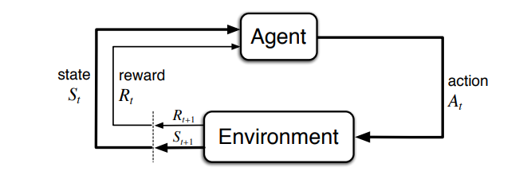

# Reinforcement Learning – Chapter 3: Finite Markov Decision Processes

MDPs are a classical formalization of **sequential decision making**: actions influence not just immediate rewards, but also subsequent situations (states) and, through them, future rewards.

## The agent–environment interface

- MDPs frame the problem of **learning from interaction** to achieve a goal.
- **Agent:** the learner and decision maker.
- **Environment:** the thing the agent interacts with.
- They interact continually: the agent selects actions and the environment responds, presenting new situations (states) and rewards.

  

In a **finite** MDP, the sets of states, actions and rewards ($\mathcal{S}$, $\mathcal{A}$, $\mathcal{R}$) have a finite number of elements. The random variables $R_t$ and $S_t$ then have well-defined discrete probability distributions that depend **only on the preceding state and action**:

$$
p(s',r \mid s,a) \doteq \Pr\{S_t = s',\, R_t = r \mid S_{t-1} = s,\, A_{t-1} = a\}
$$

- $p : \mathcal{S} \times \mathcal{R} \times \mathcal{S} \times \mathcal{A} \rightarrow [0,1]$ defines the **dynamics** of the MDP.
- It is a probability distribution for each choice of $s$ and $a$:

$$
\sum_{s' \in \mathcal{S}} \sum_{r \in \mathcal{R}} p(s',r \mid s,a) = 1, \qquad \text{for all } s \in \mathcal{S},\ a \in \mathcal{A}(s)
$$

- The probabilities given by $p$ **completely characterize** the environment's dynamics.
- **Markov property:** the state must include information about all aspects of the past interaction that make a difference for the future.

From $p$ one can compute anything else about the environment:

- **State-transition probabilities:**

$$
p(s' \mid s,a) \doteq \Pr\{S_t = s' \mid S_{t-1} = s,\, A_{t-1} = a\} = \sum_{r \in \mathcal{R}} p(s',r \mid s,a)
$$

- **Expected reward for state–action–next-state triples:**

$$
r(s,a,s') \doteq \mathbb{E}\left[R_t \mid S_{t-1} = s,\, A_{t-1} = a,\, S_t = s'\right] = \sum_{r \in \mathcal{R}} r \, \frac{p(s',r \mid s,a)}{p(s' \mid s,a)}
$$

The framework is abstract and flexible:

- **Actions** can be any decisions we want to learn how to make.
- **States** can be anything we can know that might be useful in making them.
- **Boundary rule:** anything that cannot be changed arbitrarily by the agent is part of the environment.
- The boundary is the limit of the agent's **absolute control**, not of its knowledge. Not everything in the environment is unknown to the agent.

## Goals and rewards

- The goal of the agent is formalized as a special signal, the **reward**, passing from the environment to the agent.
- The agent maximizes not the immediate reward, but the **cumulative reward in the long run**.
- **Reward hypothesis:** all we mean by goals and purposes can be well thought of as the maximization of the expected value of the cumulative sum of a received scalar signal (the reward).
- Rewards must truly indicate **what** we want accomplished, not **how** the agent should achieve it.

## Returns and episodes

The agent maximizes the **expected return** $G_t$, a function of the reward sequence. In the simplest case, the sum of the rewards:

$$
G_t \doteq R_{t+1} + R_{t+2} + R_{t+3} + \dots + R_T
$$

where $T$ is the final time step.

- **Episodic tasks:** the interaction breaks naturally into **episodes**. Each one ends in a **terminal state**, followed by a reset to a standard starting state (or a sample from a distribution of starting states).
- **Continuing tasks:** the interaction goes on without limit. Then $T = \infty$ and the return could easily be infinite.

**Discounting** solves this:

$$
G_t \doteq R_{t+1} + \gamma R_{t+2} + \gamma^2 R_{t+3} + \dots = \sum_{k=0}^{\infty} \gamma^k R_{t+k+1}
$$

where $0 \leq \gamma \leq 1$ is the **discount rate**.

- A reward received $k$ steps in the future is worth only $\gamma^{k-1}$ times what it would be worth if received immediately.
- If $\gamma < 1$, the infinite sum is finite as long as the reward sequence is bounded.
- $\gamma = 0$: the agent is **myopic**, it only maximizes immediate rewards.
- $\gamma \to 1$: future rewards weigh more and the agent becomes more **farsighted**.

Returns at successive time steps are related recursively, which makes them easier to compute:

$$
G_t = R_{t+1} + \gamma G_{t+1}
$$

Although the return is a sum of infinitely many terms, it is still finite if the reward is nonzero and constant and $\gamma < 1$.