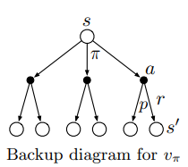
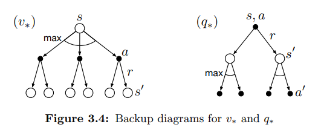

# Reinforcement Learning – Chapter 4: Value Functions and Bellman Equations

## Value functions

- **Value functions** estimate **how good** it is for the agent to be in a state (or to take an action in a state).
- "How good" is measured by the **expected return** (future rewards).
- They depend on *how the agent acts*, so they are defined with respect to a **policy**.

### Policy

A **policy** is a mapping from states to probabilities of selecting each possible action:

$$
\pi(a \mid s) = \Pr\{A_t = a \mid S_t = s\}
$$

- It is an ordinary function: for each $s \in \mathcal{S}$ it defines a **probability distribution** over $a \in \mathcal{A}(s)$.
- RL methods specify **how the policy changes** as a result of experience.

> **Exercise 3.11:** expectation of $R_{t+1}$ given $S_t = s$ under a stochastic policy $\pi$:
>
> $$\mathbb{E}[R_{t+1} \mid S_t = s] = \sum_a \pi(a \mid s) \sum_{s',r} p(s',r \mid s,a)\, r$$
>
> (Average over actions with $\pi$, then over outcomes with $p$.)

### State-value and action-value functions

- **State-value function** $v_\pi(s)$: expected return starting in $s$ and following $\pi$ thereafter.

$$
v_\pi(s) \doteq \mathbb{E}_\pi[G_t \mid S_t = s] = \mathbb{E}_\pi\left[\sum_{k=0}^{\infty} \gamma^k R_{t+k+1} \,\middle|\, S_t = s\right], \qquad \text{for all } s \in \mathcal{S}
$$

- **Action-value function** $q_\pi(s,a)$: expected return starting in $s$, taking action $a$, and then following $\pi$.

$$
q_\pi(s,a) \doteq \mathbb{E}_\pi[G_t \mid S_t = s, A_t = a] = \mathbb{E}_\pi\left[\sum_{k=0}^{\infty} \gamma^k R_{t+k+1} \,\middle|\, S_t = s, A_t = a\right]
$$

- $\mathbb{E}_\pi$ is the expected value when the agent follows $\pi$ ($t$ is any time step).

### Estimating them from experience

- **Monte Carlo methods:** keep an **average** of the real returns that followed each state (or state-action pair). As the number of visits $\to \infty$, the average converges to $v_\pi(s)$ (or $q_\pi(s,a)$).
- **Function approximation:** with too many states, keeping one average per state is impractical. Instead, use a **parameterized function** (fewer parameters than states) and adjust the parameters to match the observed returns. Accuracy depends a lot on the chosen function.

## The Bellman equation for $v_\pi$

Value functions satisfy a **recursive relationship**: the value of a state is related to the value of its successor states.

$$
v_\pi(s) = \sum_a \pi(a \mid s) \sum_{s',r} p(s',r \mid s,a)\left[r + \gamma\, v_\pi(s')\right], \qquad \text{for all } s \in \mathcal{S}
$$

- It is a sum over all values of $a$, $s'$ and $r$.
- For each triple, the probability is $\pi(a \mid s)\, p(s',r \mid s,a)$. We weight the bracket by it and add everything up.
- **Meaning:** the value of the start state = the **expected** (reward + discounted value of the next state).

### Backup diagrams

  

- **Open circle** = state. **Solid circle** = state-action pair.
- From the root $s$, the agent picks an action (following $\pi$), and the environment answers with a next state $s'$ and a reward $r$ (following $p$).
- The Bellman equation **averages over all these possibilities**, each weighted by its probability.
- They are called **backup diagrams** because they show the operations at the heart of RL: **transferring value information back** to a state (or state-action pair) from its successors.

## Optimal policies and optimal value functions

- **Solving** an RL task = finding a policy that gets a lot of reward in the long run.
- Value functions give a **partial ordering** over policies:

$$
\pi \geq \pi' \iff v_\pi(s) \geq v_{\pi'}(s) \quad \text{for all } s \in \mathcal{S}
$$

- There is always **at least one** policy better than or equal to all the others: the **optimal policy** $\pi_*$ (there may be several, all share the same value functions).

**Optimal state-value function:**

$$
v_*(s) \doteq \max_\pi v_\pi(s)
$$

**Optimal action-value function:**

$$
q_*(s,a) \doteq \max_\pi q_\pi(s,a) = \mathbb{E}\left[R_{t+1} + \gamma\, v_*(S_{t+1}) \mid S_t = s, A_t = a\right]
$$

- $q_*(s,a)$ = expected return of taking $a$ in $s$ and then following an optimal policy.

### Bellman optimality equations

The value of a state under an optimal policy must equal the expected return of the **best action** from that state:

$$
v_*(s) = \max_{a \in \mathcal{A}(s)} \sum_{s',r} p(s',r \mid s,a)\left[r + \gamma\, v_*(s')\right]
$$

$$
q_*(s,a) = \sum_{s',r} p(s',r \mid s,a)\left[r + \gamma \max_{a'} q_*(s',a')\right]
$$

  

- Same as the backup diagrams for $v_\pi$ and $q_\pi$, but with **arcs at the agent's choice points**: we take the **maximum** over the choice instead of the expectation under a policy.

### Solving the equations

- For a finite MDP, the Bellman optimality equation for $v_*$ has a **unique solution**.
- It is a **system of $n$ nonlinear equations with $n$ unknowns** (one per state).
- If the dynamics $p$ are known, we could solve it directly to get $v_*$.

### From $v_*$ and $q_*$ to an optimal policy

- **With $v_*$:** do a **one-step search**. Any policy that gives nonzero probability only to the actions that reach the maximum is optimal. In other words, any policy **greedy** with respect to $v_*$ is optimal.
  - Why it works: $v_*$ already includes the reward consequences of **all future behaviour**, so a short-term (one-step) look is also optimal in the long term.
- **With $q_*$:** even easier. Just pick the action that maximizes $q_*(s,a)$.
  - $q_*$ **caches** the results of the one-step searches.
  - We don't need to know the successor states or the environment's dynamics.
  - Cost: we must represent a function of state-action pairs instead of only states.

## Optimality and approximation

Solving the Bellman optimality equation is like an **exhaustive search** and it is rarely useful in practice. It relies on assumptions that are rarely true:

- We **accurately know the dynamics** of the environment.
- We have **enough computational resources** to compute the solution.
- The **Markov property** holds.

> **Important:** in RL we usually have to settle for **approximate solutions**.

- Optimality is an **ideal** that agents can only approximate. It still gives a framework to understand the theory of learning algorithms.
- **Computation** (per time step) and **memory** are key constraints.
- **Tabular case:** small, finite state sets, so we can use arrays or tables with one entry per state (or state-action pair). These are called **tabular methods**.
- In most interesting cases there are far more states than table entries, so the functions must be approximated with a **compact parameterized representation**.